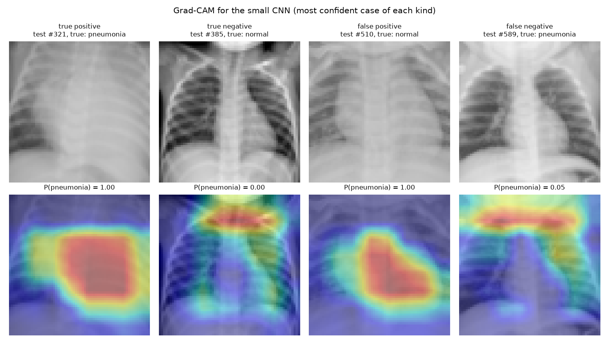
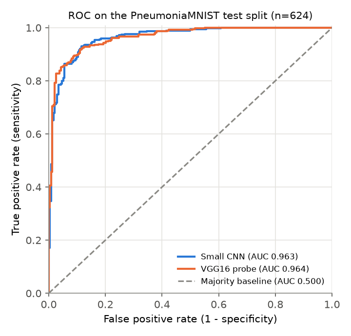
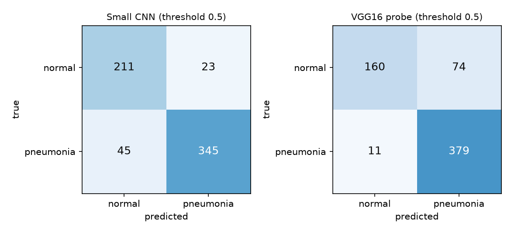
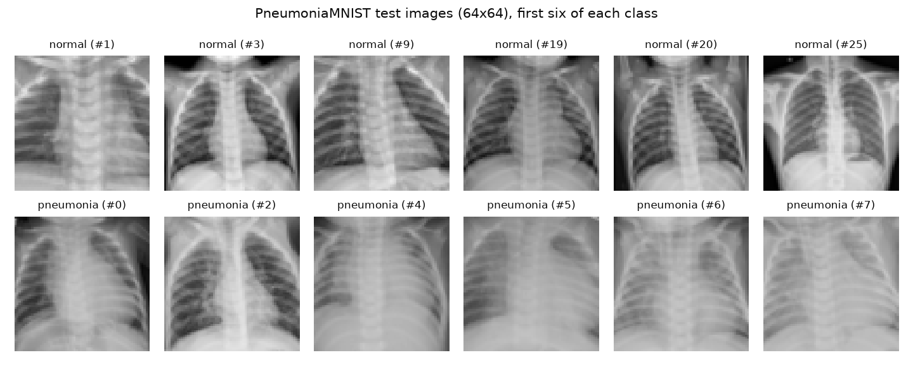

# Medical image analysis: pneumonia on chest X-rays

A learning project in medical image classification. It trains two small models to tell pneumonia from normal on 5,856 real paediatric chest X-rays (PneumoniaMNIST), scores them once on the official held-out test set against a majority-class baseline, and uses Grad-CAM to show which parts of an X-ray drove the CNN's call. It is for people who want to see how to train and check an image classifier on medical data, end to end, on a laptop CPU.

**This is not a diagnostic tool. Do not use it on patients.**



*Grad-CAM for the small CNN on four test images: the most confident true positive, true negative, false positive and false negative. Red marks the regions that pushed the model hardest towards its call.*

## Results

Official PneumoniaMNIST test split: 624 images (234 normal, 390 pneumonia). The threshold of 0.5 was fixed before training, and every choice (epoch, regularisation) was made on the validation split. The test split was scored once, at the end.

| Model | Accuracy | ROC AUC (95% CI) | Sensitivity | Specificity |
|---|---|---|---|---|
| Majority baseline (always "pneumonia") | 0.625 | 0.500 | 1.000 | 0.000 |
| Small CNN, trained from scratch | **0.891** | 0.963 (0.948 to 0.976) | 0.885 | **0.902** |
| VGG16 probe (frozen ImageNet features + logistic regression) | 0.864 | 0.964 (0.950 to 0.976) | **0.972** | 0.684 |

Sensitivity is the share of pneumonia cases the model catches; specificity is the share of normal X-rays it clears. The AUC interval comes from 2,000 bootstrap resamples of the test set. Every number here is in [docs/results.json](docs/results.json) and comes from one run of `python medical_image_analysis.py train` (seed 42). An earlier run gave the same numbers to the last digit.

What the numbers say:

- Both models beat the baseline by a wide margin: AUC 0.96 against 0.50, and accuracy of 89% and 86% against 62.5%.
- The two models rank cases equally well; their AUC intervals overlap almost fully. They differ at the 0.5 threshold. The CNN splits its errors (45 missed pneumonia cases, 23 false alarms). The VGG16 probe misses only 11 pneumonia cases but flags 74 of the 234 normal X-rays.
- Both do worse on test than on validation (CNN validation AUC 0.990, test 0.963). The test images are a separate held-out set in the source data, with a different class mix (62.5% pneumonia against 74% in training), so validation scores overstate how well the models carry over.
- For context, the MedMNIST v2 paper reports test AUC of 0.944 to 0.962 and accuracy of 0.854 to 0.884 for ResNet-18 and ResNet-50 on this task at 28x28 and 224x224. These results sit in the same range, but the setups differ, so it is not a like-for-like comparison.

<p>
  
  
</p>

**What Grad-CAM shows.** In the two pneumonia calls at the top of this page, the heat sits over the centre and lower chest. In the two normal calls, one of them a missed pneumonia case, it sits on the neck and collarbones, outside the lungs. Four images prove nothing, but this hints that the CNN may lean on cues outside the lungs, such as how the image is framed, when it calls an X-ray normal.

The test images look like this at 64x64:



Training curves for the CNN are in [docs/training_curves.png](docs/training_curves.png).

## How it works

1. **Data.** `train` downloads `pneumoniamnist_64.npz` (20 MB) from Zenodo, checks its MD5, and loads the official train, validation and test splits (4,708 / 524 / 624 greyscale images, 64x64). Pixel values are scaled to 0 to 1.
2. **Baseline.** Always predict the most common class in the training set (pneumonia, 74% of training images).
3. **Small CNN** (240,385 parameters, Keras). Four 3x3 conv layers with 32, 64, 128 and 128 filters, max pooling after the first three, global average pooling, dropout of 0.3 and one sigmoid output. Training adds small random rotations, shifts and zooms (no flips, since the heart sits on one side), weights both classes equally in the loss, and runs Adam (learning rate 0.001, batch size 64) for up to 25 epochs. It keeps the weights from the epoch with the best validation AUC (epoch 21 of 25 in this run).
4. **VGG16 probe.** Each grey image is copied to three channels and passed through VGG16 with frozen ImageNet weights, which gives 512 features per image. A class-balanced logistic regression is fitted on the training features. Its regularisation strength C is picked from 0.001, 0.01, 0.1 and 1 on validation AUC (0.01 won).
5. **Evaluation.** Both models score the test split once, with a threshold of 0.5. The script reports accuracy, ROC AUC with a bootstrap 95% interval, sensitivity, specificity and the confusion matrix.
6. **Grad-CAM.** For the CNN, take the gradient of the output logit with respect to the last conv layer (128 maps of 8x8), average it over each map to get a weight per map, sum the weighted maps, keep the positive part and scale it up to 64x64. For a "normal" call the logit's sign is flipped, so the map shows what pushed the model towards normal.

All code is in [medical_image_analysis.py](medical_image_analysis.py). Quick tests are in [tests/](tests/).

## How to run

Tested with Python 3.12, TensorFlow 2.21 and Keras 3.15 on Windows 11, CPU only.

```bash
git clone https://github.com/Letsapatiiso07/medical-image-analysis.git
cd medical-image-analysis
python -m venv .venv
source .venv/bin/activate          # Windows: .venv\Scripts\activate
pip install -r requirements.txt

python -m pytest -q                                  # 8 quick tests, no download
python medical_image_analysis.py train               # download, train, evaluate, write docs/
python medical_image_analysis.py predict --test-index 589
python medical_image_analysis.py predict path/to/xray.png
```

`train` took about 11 minutes on 2 CPU threads: 8 for the CNN and 2 for the VGG16 probe. It writes the figures and `results.json` to `docs/` and saves the CNN to `models/small_cnn.keras`, which `predict` loads. The script uses 2 threads by default; set the `TF_THREADS` environment variable to use more. `train --skip-vgg16` trains the CNN only.

`predict` prints the CNN's score. Test image 589 is the missed pneumonia case in the Grad-CAM figure:

```
prediction: normal  P(pneumonia) = 0.049  (threshold 0.5)
true label: pneumonia
```

For your own image, the script centre-crops it to a square and shrinks it to 64x64 greyscale. The score is a model output, not a calibrated chance of disease.

## Data source

PneumoniaMNIST from MedMNIST (Yang et al., 2023), at 64x64 from the MedMNIST+ files on [Zenodo](https://zenodo.org/records/10519652). It is built from the paediatric chest X-ray set of Kermany et al. (2018): 5,856 front-view X-rays of children aged one to five from Guangzhou Women and Children's Medical Center, labelled normal or pneumonia. MedMNIST centre-crops and resizes the images, keeps the source's 624 held-out images as the test split, and splits the rest 9:1 into train and validation. The data is not stored in this repo; `train` downloads it.

## Licence and citation

The code is under the MIT licence (see [LICENSE](LICENSE)). The data is under CC BY 4.0. If you use the data, cite both papers:

- Jiancheng Yang, Rui Shi, Donglai Wei, Zequan Liu, Lin Zhao, Bilian Ke, Hanspeter Pfister, Bingbing Ni. "MedMNIST v2: A large-scale lightweight benchmark for 2D and 3D biomedical image classification." *Scientific Data* 10, 41 (2023). https://doi.org/10.1038/s41597-022-01721-8
- Daniel S. Kermany, Michael Goldbaum, Wenjia Cai, et al. "Identifying medical diagnoses and treatable diseases by image-based deep learning." *Cell* 172(5), 1122-1131.e9 (2018). https://doi.org/10.1016/j.cell.2018.02.010

## Limits and next steps

Limits:

- It is not a medical device. Nobody has checked it in a clinic, and it must not guide care.
- At 64x64 most of the detail a radiologist would use is gone.
- All images come from one hospital and from children aged one to five. Nothing here shows it works on adults or other scanners.
- The results come from one training run with one seed. The bootstrap interval covers test-set sampling, not training randomness.
- The 0.5 threshold is fixed and the scores are not calibrated.
- Grad-CAM at 8x8 is coarse, and the four examples were picked as the most confident of each kind, not as a survey.

Next steps:

- Run Grad-CAM over the whole test set to check whether normal calls rely on the neck region, and try cropping to the lung fields.
- Train over several seeds and report the spread.
- Pick the threshold on the validation split for a set sensitivity target, and calibrate the scores.
- Try 128x128 images and fine-tune a pretrained network instead of a frozen probe.

## Author

Tiiso Letsapa, Letsapamyron07@gmail.com
